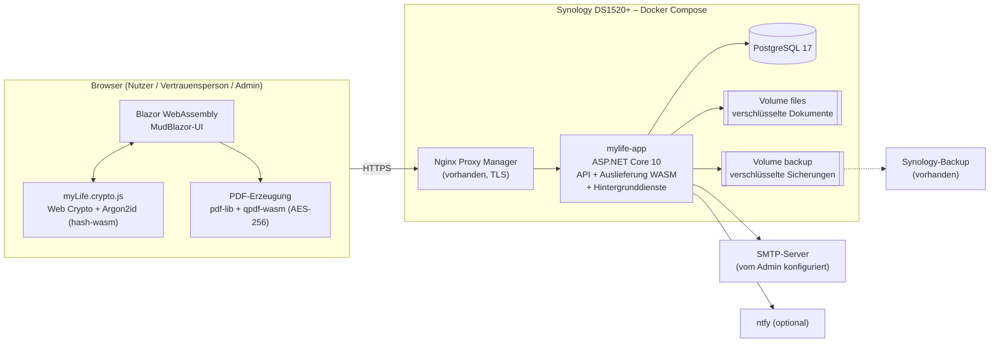
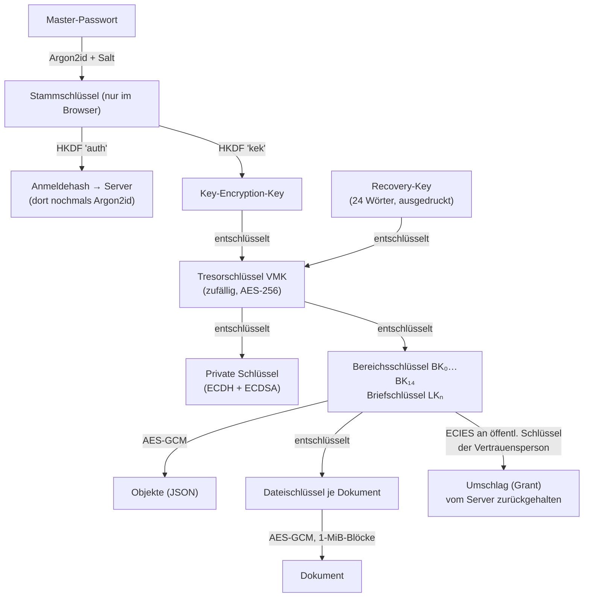
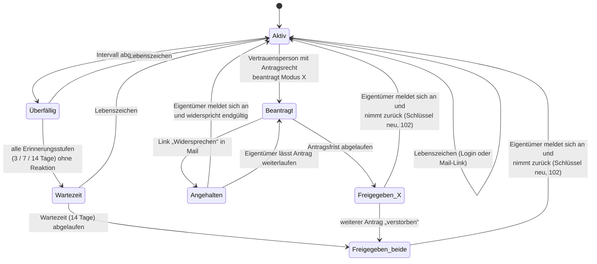
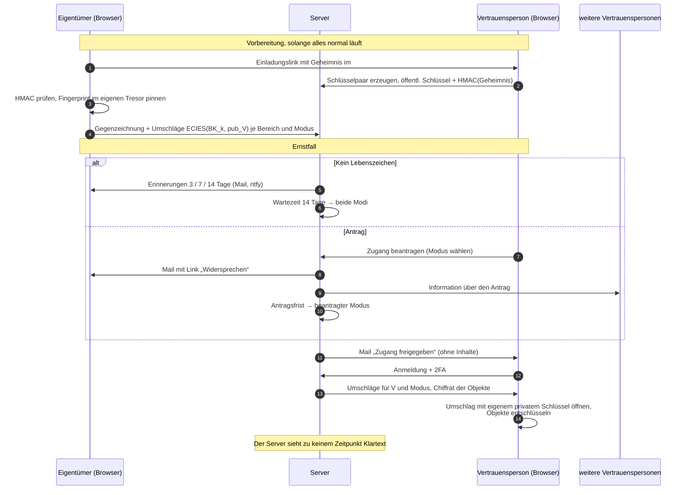

# myLife – Architektur

Stand: 26.11.2026, Version 1.1.0 (Entwurf vom 24.11.2026, seitdem fortgeschrieben). Die Nummern in Klammern verweisen auf das [Entscheidungsprotokoll](entscheidungen.md). Bereiche und Objekttypen stehen in [objekttypen.md](objekttypen.md).

## 1. Leitprinzipien

1. **Zero-Knowledge:** Klartext gibt es nur im Browser. Der Server speichert und verteilt ausschließlich Chiffrat. Er kennt nur die Metadaten, die er für seine Aufgaben braucht (Abschnitt 6.4).
2. **Die Daten sind nie gefangen:** Jeder Tresor lässt sich als offenes, verschlüsseltes JSON exportieren. Ein Werkzeug zum Entschlüsseln liegt bei und läuft offline.
3. **Der Notfall ist der Ernstfall:** Der Notfallzugang muss nach Jahren ohne Wartung noch funktionieren. Deshalb gibt es wenige bewegliche Teile, einen Zustandsautomaten, der Neustarts übersteht, und Papier als Rückfallebene.
4. **Einfach für die Familie:** Der Lesemodus ist ruhig und linear und folgt der Checkliste.

## 2. Nutzer und Rollen (34, 35)

Eine myLife-Instanz gehört **einer Familie**. Es gibt keine öffentliche Registrierung und keine Mandanten.

| Rolle | Darf |
| --- | --- |
| **Nutzer** | Führt seinen **eigenen Tresor**. Benennt andere Nutzer als **Vertrauenspersonen** und legt fest, welche Bereiche sie je Modus sehen dürfen und ob sie einen Zugang beantragen dürfen. Ist selbst Vertrauensperson für andere. Gibt Lebenszeichen ab. |
| **Administrator** | Ein Nutzer mit Zusatzrecht. Verwaltet die globalen Einstellungen: SMTP und ntfy, Standard- und Grenzwerte der Fristen, automatische Abmeldung, Dateigrößen, Sicherungen, Datenschutzhinweis. Verwaltet Benutzer: einladen, sperren, löschen, 2FA zurücksetzen. Sieht das System-Audit-Log. **Kein Zugriff auf Tresorinhalte** und keine Möglichkeit, eine Freigabe auszulösen oder Fristen eines Nutzers abzukürzen. |

- Der erste Nutzer wird im Einrichtungsassistenten angelegt und ist Administrator. Weitere Admins sind möglich.
- Eine Vertrauensperson ist immer ein Nutzer der Instanz. Ihr eigener Tresor darf leer bleiben.
- Jeder Nutzer lädt seine Vertrauenspersonen selbst ein, dabei entsteht ein Konto (42). Der Admin sieht alle Konten und kann sie sperren.
- **Sofort teilen (46b):** Zusätzlich zu den Notfall-Freigaben kann ein Nutzer einzelne Bereiche **schon zu Lebzeiten** mit ausgewählten Vertrauenspersonen teilen, nur zum Lesen. Technisch ist das ein Umschlag mit dem Modus `Live`, den der Server sofort ausliefert. Wird das Teilen beendet, erzeugt der Browser des Eigentümers einen neuen Bereichsschlüssel.

## 3. Komponenten

| Komponente | Aufgabe |
| --- | --- |
| **MyLife.Client** | Blazor WebAssembly, die gesamte Oberfläche (MudBlazor), Lokalisierung de/en, Suche, Formulare und Datenblätter aus den Objekttyp-Schemata, Lesemodus, Admin-Bereich, Hilfe (Tutorial und Anleitung, 139), Übersicht „Zahlungen“ (142) |
| **MyLife.Crypto** | C#-Fassade über `myLife.crypto.js`. Dazu eine .NET-Referenzimplementierung derselben Formate, die für Tests und für das Kommandozeilen-Werkzeug `mylife-decrypt` dient. |
| **MyLife.Shared** | DTOs, Tresor-Nutzlast (`VaultPayload`), Formatversionen, Validierung. Die **Objekttyp-Schemata** (Bereiche, Felder, Auswahllisten, Wünsche, Verweise) und ihre Texte kommen aus dem Paket **MyCommon.Catalog** (Repo `my-common`, gemeinsam mit myDocs, 144). |
| **MyLife.Server** | ASP.NET Core: liefert den WASM-Client aus (Blazor Web App, globales Interactive WebAssembly, **ohne Prerendering**) und stellt die REST-API bereit. Außerdem Authentifizierung, EF Core mit Npgsql, Audit-Log, Mail-Outbox und die Hintergrunddienste Notfallzugang, Erinnerungen und Sicherung. |
| **MyLife.Decrypt** | Kommandozeilen-Werkzeug `mylife-decrypt` (M3.5): öffnet JSON-Exporte und Notfallpakete ohne Server, mit der .NET-Referenz aus MyLife.Crypto. Die CI baut eigenständige Dateien für Windows, macOS und Linux. |
| **MyLife.OfflineViewer** | Eine einzelne HTML-Datei ohne Netzwerkzugriff, die ein Notfallpaket entschlüsselt und anzeigt (4b). Kein eigenes Projekt: Der Client bettet die Datei als Vorlage ein und füllt sie beim Erzeugen (M2.7). |
| **Tests** | xUnit (Server, Domänenlogik, Zustandsautomat mit simulierter Uhr), bUnit (Komponenten), Playwright (Krypto im echten Browser, Ende-zu-Ende-Abläufe), Kreuztests JS gegen .NET |

### Warum Blazor WebAssembly (7)

Bei Blazor Server läuft die Komponentenlogik auf dem Server. Jeder entschlüsselte Wert würde dort im Speicher liegen und über die SignalR-Verbindung übertragen. Zero-Knowledge wäre damit nicht möglich. Bei WebAssembly läuft der gesamte UI-Code im Browser, der Server sieht nur API-Aufrufe mit Chiffrat. Prerendering bleibt aus, damit nie Komponentenzustand auf dem Server entsteht.

### Warum die Web Crypto API (7)

- Die Implementierungen sind nativ, geprüft und laufen in konstanter Zeit, und Schlüssel lassen sich als **nicht exportierbar** markieren. Damit kommt selbst Code im Browser nicht an die Schlüsselbytes.
- `System.Security.Cryptography` ist unter Blazor WebAssembly größtenteils nicht verfügbar (AES-GCM fehlt zum Beispiel).
- Argon2id ist nicht Teil der Web Crypto API. Dafür nutzt myLife **hash-wasm**: MIT-Lizenz, gepflegt, ohne Abhängigkeiten, gegen die RFC-9106-Testvektoren geprüft. Die Datei wird lokal ausgeliefert, kein CDN.

### Restrisiko bei Web-Apps mit Zero-Knowledge

Der Server liefert den Code aus, der die Daten entschlüsselt. Ein kompromittierter Server könnte manipulierten JavaScript-Code ausliefern. Dagegen helfen:

- Self-Hosting, eine strikte Content Security Policy (`script-src 'self' 'wasm-unsafe-eval'`, kein `unsafe-inline`), Subresource Integrity und offene Quellen mit reproduzierbarem Build.
- Ganz beseitigen lässt sich das Risiko nicht. Die Dokumentation nennt es ehrlich.

## 4. Schlüsselkonzept

### 4.1 Algorithmen

| Zweck | Verfahren |
| --- | --- |
| Ableitung aus dem Passwort | **Argon2id**, m = 64 MiB, t = 3, p = 1, Salt 16 Byte. Die Parameter werden mit dem Datensatz gespeichert, damit sie später angehoben werden können. |
| Trennung der Teilschlüssel | **HKDF-SHA-256** mit getrennten `info`-Werten (`mylife/auth`, `mylife/kek`) |
| Symmetrische Verschlüsselung | **AES-256-GCM**, zufälliger Nonce mit 96 Bit, AAD = Objekttyp, Objekt-ID und Formatversion |
| Asymmetrisch (Umschläge) | **ECDH P-256** mit ephemerem Schlüssel, dann HKDF und AES-256-GCM (ECIES-Muster). P-256 statt X25519, weil es in allen Browsern und in .NET gleich verfügbar ist. |
| Signatur | ECDSA P-256 (Identitätsschlüssel je Nutzer) |
| Wiederherstellungs-Schlüssel | 256 Bit Zufall, als 24 Wörter (englische BIP-39-Standardliste, 50) und als QR-Code |

### 4.2 Schlüsselhierarchie (je Nutzer)

- **Passwort ändern:** Nur der VMK wird neu verpackt. An den Daten ändert sich nichts.
- **Recovery-Key:** Er verpackt den VMK ein zweites Mal (11). Nach einer Wiederherstellung muss ein neues Passwort gesetzt werden, auf Wunsch entsteht auch ein neuer Recovery-Key.
- **Jeder Nutzer** hat dieselbe Kette und ein eigenes Schlüsselpaar. Der private Schlüssel liegt nur verpackt auf dem Server.
- **Umschläge (Grants):** Für jede Vertrauensperson, jeden freigegebenen Bereich oder Brief und jeden Modus (verstorben oder handlungsunfähig) verschlüsselt der Browser des Eigentümers den Bereichsschlüssel mit dem öffentlichen Schlüssel der Person. Der Server liefert einen Umschlag erst aus, wenn der Notfallzugang des Eigentümers für diese Person und diesen Modus freigegeben ist (10a).
- **Freigaben zurücknehmen:** Vor einer Freigabe genügt es, den Umschlag zu löschen. Nach einer Freigabe nimmt der angemeldete Eigentümer sie unter „Notfallzugang“ zurück; sein Browser erzeugt dann neue Bereichsschlüssel für die betroffenen Bereiche und neue Briefschlüssel für die betroffenen Briefe und versiegelt alle Umschläge neu (102, 103).

### 4.3 Öffentliche Schlüssel prüfen, ohne Telefon (31)

Ein manipulierter Server könnte einen falschen öffentlichen Schlüssel unterschieben. myLife prüft das automatisch, ohne Zutun der Nutzer:

1. **Bindung bei der Einladung:** Der Browser der einladenden Person erzeugt ein Einladungsgeheimnis. Es steht im Fragment des Einladungslinks (`…/einladung#geheimnis`), das Browser nie an den Server übertragen. Der Browser der eingeladenen Person signiert damit (HMAC) ihren neuen öffentlichen Schlüssel. Der Browser der einladenden Person prüft diese Signatur und gegenzeichnet den Schlüssel mit seinem Identitätsschlüssel.
2. **Pinning:** Jeder Browser speichert die Fingerprints aller Personen, mit denen er Umschläge austauscht, **verschlüsselt im eigenen Tresor**. Legt der Server später einen anderen Schlüssel vor, erzeugt myLife keine Umschläge und zeigt eine deutliche Warnung.
3. **Gegenseitige Bestätigung:** Bereits bekannte Familienmitglieder werden über die Gegenzeichnungen der anderen bestätigt (Web of Trust in klein). Wurde ein Schlüssel noch von niemandem gegengezeichnet, weist myLife sachlich darauf hin, ohne zu blockieren.

Grenze: Versendet der Server die Einladungsmail selbst, könnte ein **in diesem Moment** kompromittierter Server das Geheimnis mitlesen. Wer das ausschließen will, kopiert den Link stattdessen und schickt ihn auf eigenem Weg (Messenger). Die App bietet beide Wege an, die Mail ist Standard.

### 4.4 Anmeldung (8)

1. Der Browser holt Salt und Argon2-Parameter zur E-Mail-Adresse. Für unbekannte Adressen gibt es deterministische Scheinwerte, damit sich nicht erkennen lässt, welche Adressen existieren.
2. Der Browser berechnet den Stammschlüssel und daraus den Anmeldehash. Der Server prüft ihn gegen seinen eigenen Argon2id-Hash.
3. Zweiter Faktor: **TOTP** oder **Passkey** über WebAuthn (Bibliothek Fido2NetLib). Das TOTP-Geheimnis liegt mit ASP.NET Data Protection verschlüsselt in der Datenbank.
4. Danach setzt der Server ein Sitzungs-Cookie (`HttpOnly`, `Secure`, `SameSite=Strict`) mit gleitender Laufzeit. Dazu kommen Antiforgery-Schutz, Rate-Limiting und eine Sperre nach mehreren Fehlversuchen.
5. Der Browser entpackt den VMK als **nicht exportierbaren** CryptoKey. Schlüssel liegen nur im Arbeitsspeicher, nie im Local Storage.
6. **Automatische Abmeldung** nach Inaktivität (Zeit vom Admin vorgegeben). Dabei werden alle Schlüssel und entschlüsselten Daten im Speicher verworfen.
7. **Neuladen:** Die Sitzung bleibt, der Tresor ist gesperrt. Entsperren nur mit dem Passwort, geprüft im Browser (55).
8. **Fehlversuche:** Nach 5 Fehlversuchen 15 Minuten Sperre (57). Jeder TOTP-Code gilt nur einmal. Zwischenschritte (Passwort geprüft, zweiter Faktor fehlt) tragen ein geschütztes Token mit 5 Minuten Laufzeit; der Server hält dafür keinen Zustand.
9. **Wiederherstellung:** Der Browser beweist mit einem Prüfwert aus dem Recovery-Key, dass er die 24 Wörter kennt, und packt den VMK auf ein neues Passwort um. Der zweite Faktor bleibt (54).
10. **Passkeys** (WebAuthn über Fido2NetLib) ersetzen den TOTP-Code als zweiten Faktor. Relying Party ist der Host hinter dem Proxy.
11. **CSRF:** Schreibende API-Aufrufe brauchen den Header `X-MyLife-Request` (56).

## 5. Notfallzugang

### 5.1 Zustandsautomat (je Nutzer)

- **Kein Lebenszeichen** gibt **beide Modi** frei (32). Ein **Antrag** gibt nur den beantragten Modus frei.
- Der Dienst `EmergencySwitchService` (ein `BackgroundService`) prüft alle 15 Minuten. Jeder Übergang ist idempotent, wird gespeichert und im Audit-Log protokolliert. Nach einem Neustart setzt der Dienst einfach wieder ein.
- Zeiten laufen über `TimeProvider`. Dadurch lassen sich alle Übergänge in Tests vollständig simulieren.
- **Fristen:** Jeder Nutzer wählt seine Werte innerhalb der Grenzen, die der Admin vorgibt (43).
- **Lebenszeichen-Link (13):** Ein Token mit 256 Bit, einmal verwendbar und zeitlich begrenzt. Die Datenbank speichert nur seinen Hash. Der Link setzt ausschließlich das Lebenszeichen.
- **Antrag (14, 33):** Der Antrag geht an den Eigentümer (Mail mit dem Link „Widersprechen“, der sofort anhält, 15) und informiert **alle anderen Vertrauenspersonen** des Eigentümers.
- **Mailausfall:** Ist der SMTP-Versand gestört, verlängert der Dienst die Fristen automatisch und meldet das dem Admin und im Dashboard. Ein Mailausfall darf nie zu einer Freigabe führen.
- **Nach der Freigabe** „verstorben“ bleibt der Zugriff unbegrenzt (36). Alle Vertrauenspersonen mit Freigabe können gemeinsam „Tresor endgültig löschen“ auslösen. Dafür müssen alle zustimmen; gelöscht wird 7 Tage nach der letzten Zustimmung, bis dahin kann jede Person zurückziehen und der Eigentümer zurücknehmen (104, 105).

### 5.2 Ablauf der Freigabe

Bekannte Grenze von 10a: Der Server entscheidet, wann er die Umschläge herausgibt. Wer direkten Zugriff auf Server und Datenbank hat und mit einer Vertrauensperson zusammenarbeitet, könnte die Freigabe vorziehen. Die Admin-Rolle in der App kann das nicht, nur der Betreiber der Synology. Das ist akzeptiert. Shamir Secret Sharing (10b) ist als Erweiterung vorgesehen.

## 6. Datenmodell (PostgreSQL)

### 6.1 Tabellen

🔒 = Chiffrat

| Tabelle | Wichtige Felder |
| --- | --- |
| `users` | Id, E-Mail, Anzeigename, IsAdmin, Status (eingeladen/aktiv/gesperrt), Sprache, AuthHash, KdfSalt, KdfParams, 🔒WrappedVmk, 🔒WrappedVmkByRecovery, 🔒WrappedPrivateKeys, PublicEncKey, PublicSignKey, TotpSecret (Data Protection), LastLoginAt, IsDeleted |
| `passkeys` | UserId, CredentialId, PublicKey, SignCount, Name |
| `invitations` | Id, InviterId, E-Mail, Sprache, TokenHash, 🔒Einladungsgeheimnis, ExpiresAt, AcceptedAt, InviteeId, Bindung (HMAC), VerifiedAt, MismatchAt, RevokedAt |
| `key_endorsements` | SignerId, SubjectId, Fingerprint, Signatur, At |
| `pinned_keys` | OwnerId, SubjectId, 🔒Fingerprint, UpdatedAt |
| `trust_relations` | OwnerId, TrusteeId, 🔒Profil (Beziehung, Notiz), CanRequestAccess, CreatedAt |
| `areas` | Id, OwnerId, AreaKey (0–14), 🔒WrappedAreaKey, LastReviewedAt |
| `objects` | Id, AreaId, TypeKey (bankAccount, insurance, …), 🔒Payload (alle Felder, Wunsch, Verweise, Notizen als JSON), 🔒WrappedKey (nur Briefe: eigener Objektschlüssel), SchemaVersion, Status, CreatedAt, UpdatedAt, IsDeleted, DeletedAt, `xmin` |
| `documents` | Id, ObjectId, 🔒WrappedFileKey, 🔒Metadata (Bezeichnung, Dateiname, Typ, Datum), CipherSize, StorageKey, CipherSha256, IsDeleted |
| `grants` | Id, OwnerId, TrusteeId, Ressource (AreaId oder ObjectId bei Briefen), Mode (Live/Death/Incapacity), 🔒Envelope, Signatur des Eigentümers, Fingerprint der Person beim Versiegeln, CreatedAt |
| `emergency_switches` | OwnerId, IntervalDays, WaitingDays, RequestWaitingDays, zweite Adresse, ntfy-Thema, LastLifesignAt, State, OverdueAt, Stufe, Mail der Stufe und ihr Versandzeitpunkt, ReleasedModes, ReleasedAt (Erinnerungstage gibt der Admin vor) |
| `access_requests` | Id, OwnerId, TrusteeId, Mode, RequestedAt, Mail an den Eigentümer, DeadlineAt (ab deren Versand), State, PausedAt, DecidedAt |
| `vault_deletion_votes` | OwnerId, TrusteeId, VotedAt |
| `one_time_tokens` | Id, Zweck (Lifesign/Objection/Invite/PasswordReset…), TokenHash, UserId, ExpiresAt, UsedAt |
| `checklist_progress` | TaskId (Aufgabe), OwnerId, DoneById, DoneAt; ein Stand je Aufgabe für alle, ohne Notiz (118) |
| `reminder_settings` | UserId, Prüfintervall (Monate), Vorlauf (Tage), Mail an/aus, NextDueOn: nur der nächste Termin ohne Bezug zum Objekt (39b), Termin der letzten Mail, letzte Prüf-Erinnerung (M3.1) |
| `settings` | Globale Einstellungen: SMTP (Passwort per Data Protection), ntfy, Standard- und Grenzwerte, Abmeldezeit, Dateigröße, Sicherung, Datenschutzhinweis |
| `audit_log` | Id, At, ActorId, OwnerId (Tresorbezug), Aktion, Objekttyp, ObjektId, IP gekürzt, Details (ohne Inhalte) |
| `mail_outbox` | Id, Empfänger, Vorlage, Sprache, Parameter, Versuche, NextAttemptAt, SentAt |

### 6.2 Objekttypen und Datenblatt (29)

- Die Objekttypen aus [objekttypen.md](objekttypen.md) sind **Schemata in `MyCommon.Catalog`** (144). Ein Schema legt fest: Bereich, Felder mit Datentyp (Text, Zahl, Betrag, Datum, IBAN, Auswahl, Ja/Nein, Verweis auf Objekt, Ablageort), Pflichtfelder, Auswahllisten (lokalisiert), mögliche Wünsche, Felder für Erinnerungen und die Gliederung des Datenblatts.
- Aus dem Schema entstehen automatisch **Formular, Datenblatt (Ansicht, Druck, PDF), Suchindex und Lesemodus**. Ein neuer Objekttyp ist damit nur ein neues Schema, kein neuer UI-Code.
- Die Objekte selbst sind verschlüsseltes JSON mit `schemaVersion`. Damit lassen sich Felder ergänzen, ohne die Datenbank zu migrieren.
- **Ablageorte (143):** Die Tabelle „Ablageorte“ ist Bereich 14 mit dem Objekttyp `location`. Felder vom Typ Ablageort speichern **Verweis und Namen**: den Verweis in `locations` der Nutzlast, den Namen im Feld selbst. Verweise über Bereichsgrenzen hinweg lösen sich sonst nur auf, wenn auch der Zielbereich freigegeben ist. So sieht eine Vertrauensperson den Ablageort mit jedem freigegebenen Eintrag, und Export, Notfallordner und `mylife-decrypt` brauchen den Verweis nicht. Benennt der Eigentümer einen Ablageort um, verschlüsselt sein Browser alle Einträge neu, die ihn nutzen. Der Server sieht davon nur die Änderungen, keine Namen.
- **Zahlungen (142):** Welche Felder eine regelmäßige Zahlung beschreiben (Betrag, Rhythmus, belastetes Konto, Bedingung), steht im Schema (`ObjectTypeDefinition.Payment`). Summiert wird im Browser aus den entschlüsselten Objekten; das Dateiformat und der Server ändern sich dadurch nicht.
- **Prüfungen im Browser** gegen „Was gehört nicht hinein“: Ein Kartennummer-Muster mit Luhn-Prüfung, Begriffe wie PIN oder TAN und eine Folge von 12 bis 24 BIP-39-Wörtern lösen eine Warnung aus. Dazu gibt es eine eigene Hinweisseite und einen Hinweis im Einrichtungsassistenten.

### 6.3 Dokumente

Der Browser zerlegt jede Datei in Blöcke von 1 MiB und verschlüsselt jeden Block mit AES-GCM. Der Nonce leitet sich aus der Blocknummer ab, das Ende der Datei wird in der AAD markiert. Ablage unter `files/<StorageKey>`. Gelöschte Dokumente kommen in den Papierkorb und werden nach 30 Tagen endgültig entfernt.

### 6.4 Was der Server weiß (30)

Er kennt die E-Mail-Adressen und Anzeigenamen der Nutzer, wer wessen Vertrauensperson ist, welche Bereiche und Objekttypen belegt sind sowie Anzahl und Größen. Er kennt die Zeitpunkte von Änderungen und Anmeldungen und den Zustand des Notfallzugangs. **Keine Inhalte**: keine Titel, Banken, Dateinamen, Beziehungen oder Notizen.

## 7. Exporte

| Export | Inhalt | Schutz |
| --- | --- | --- |
| **JSON-Export** (offenes Format) | Alle Objekte, Dokumente und Schlüsselumschläge mit dokumentiertem Schema (`docs/format.md`) | Mit dem Tresorschlüssel. Entschlüsseln geht mit Master-Passwort oder Recovery-Key, auch mit `mylife-decrypt` (M3). Der OfflineViewer öffnet nur Notfallpakete (110). |
| **Datenblatt** (29) | Ein Objekt | Druck aus dem Browser oder PDF mit optionalem Passwort |
| **Notfallordner-PDF** (20) | Alle oder ausgewählte Bereiche: Inhaltsverzeichnis, Checkliste, Datenblätter, Liste der Dokumente | PDF mit AES-256-Passwortschutz (qpdf-wasm im Browser). Alternativ eine druckfertige HTML-Ansicht ohne Passwort für den Papierordner. |
| **Notfallpaket für Vertrauenspersonen** (4b) | OfflineViewer.html mit den ausgewählten Bereichen als fertige Datenblätter, optional mit Dokumenten (107) | Verschlüsselt mit einem eigenen **Paketschlüssel** (24 Wörter, 108). Den Schlüssel gibt es nur ausgedruckt (Schließfach, Notar). Das Paket bei der Familie nützt ohne den Ausdruck nichts, und der Ausdruck ohne das Paket ebenfalls nicht. |
| **Server-Sicherung** (5) | Datenbank (Schnappschuss per `COPY`, 124), Data-Protection-Schlüssel und auf Wunsch die Dokumente, täglich, als Generationen | Die Inhalte sind ohnehin Chiffrat. Zusätzlich verschlüsselt mit dem Sicherungsschlüssel `MYLIFE_BACKUP_KEY` (125). Ablage in `/data/backup`, das Synology-Backup übernimmt von dort. Rücksicherung per `restore` (128). |

## 8. Betrieb auf der Synology DS1520+

- `docker-compose.yml` mit `mylife-app` und `postgres`. Die App lauscht nur auf einem lokalen Port, etwa 8080. Nginx Proxy Manager übernimmt TLS und leitet `mylife.eckis-corner.de` weiter (3). `X-Forwarded-*` wird nur vom Proxy angenommen.
- Images für **linux/amd64** (Celeron J4125), gebaut über GitHub Actions nach `ghcr.io/eckis-corner/mylife` (26, 28).
- Speicherbedarf: App etwa 200 MB, PostgreSQL etwa 150 MB RAM. Argon2id läuft im Browser, nicht auf der NAS.
- Volumes: `data/app` (darin `files`, `backup` und `keys`) und `data/postgres`. In `keys` liegt der Schlüsselring von ASP.NET Data Protection. Ohne ihn lassen sich TOTP-Geheimnisse und das SMTP-Passwort nicht mehr entschlüsseln, deshalb gehört `keys` in die Sicherung.
- Beim ersten Start gibt es einen **Einrichtungsassistenten**: ersten Nutzer als Admin anlegen, 2FA, Recovery-Kit drucken, SMTP einstellen und testen (SMTP folgt mit M2). Er verlangt den **Einrichtungscode** aus dem Container-Protokoll (51).
- Die Anleitungen (`docs/betrieb/`) beschreiben Installation in Container Manager und Nginx Proxy Manager, Update, Sicherung, Rücksicherung und die Übergabe an eine Nachfolgeperson (4c).

## 9. Querschnitt

- **Lokalisierung:** Ressourcen-Dateien `.resx` (de, en), auch für Schema-Bezeichnungen und Auswahllisten. Die Sprache ist pro Nutzer wählbar. Mails gehen in der Sprache der Empfängerin oder des Empfängers raus.
- **Logging:** Serilog mit Filtern, die Tokens, Hashes, Cookies und Anfrageinhalte nie protokollieren. Die Krypto-Endpunkte loggen nur IDs.
- **Audit-Log:** Anmeldung, fehlgeschlagene Anmeldung, 2FA-Änderung, Export, Änderungen an Freigaben, alle Übergänge des Notfallzugangs, Abruf von Umschlägen, Objekten und Dokumenten durch Vertrauenspersonen, Admin-Aktionen. Jeder Nutzer sieht die Einträge zu seinem Tresor, der Admin die Systemereignisse.
- **Benachrichtigung bei Admin-Aktionen:** Setzt der Admin die 2FA eines Nutzers zurück oder sperrt ihn, bekommt der Nutzer eine Mail.
- **Datenschutz:** Hinweisseite (Text vom Admin), Löschen des eigenen Kontos mit Tresor, Audit-Einträge mit gekürzter IP, Aufbewahrungsfrist der Logs einstellbar.
- **Sicherheits-Header:** CSP, HSTS (über den Proxy), `X-Content-Type-Options`, `Referrer-Policy: no-referrer`, `Permissions-Policy`.
- **Tests:** Testvektoren für jedes Krypto-Format, Kreuztests JS ↔ .NET, Simulation des Zustandsautomaten mit `FakeTimeProvider`, Playwright-Abläufe „Nutzer A legt an → Freigabe → Vertrauensperson B liest“.
